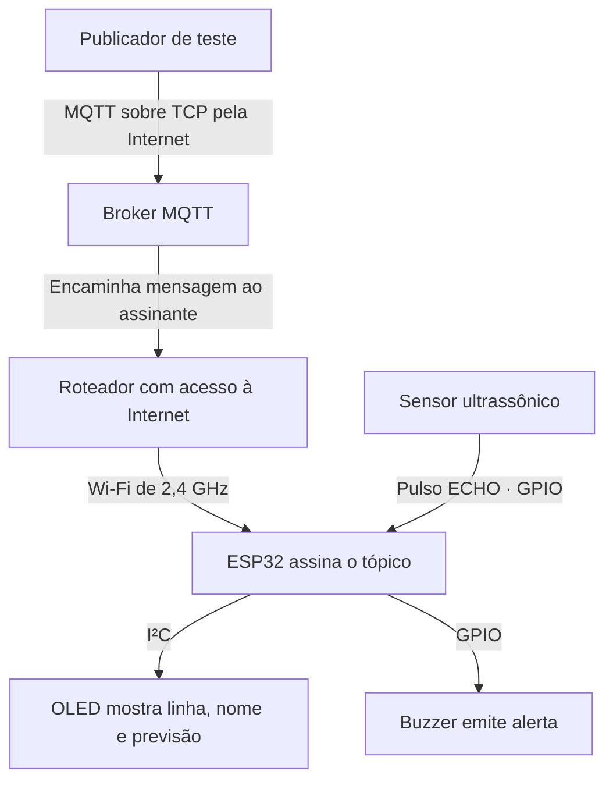

# SmartBus — Painel inteligente de ponto de ônibus

**FIAP · Global Solution 2026/2 · CitizenTech**

O SmartBus é um protótipo de painel que mostra **linha, destino e previsão de chegada** no próprio ponto de ônibus. A ideia é reduzir a incerteza de quem espera pelo transporte público e permitir a consulta sem depender de celular ou internet móvel.

## Integrantes

| Nome completo | RM |
| --- | --- |
| Andre Sousa Matuda | 566733 |
| Guilherme Barca Nascimento Silva | 568517 |
| Guilherme Oliveira Feitosa | 566842 |
| Kaliel Aquino | 567587 |
| Paulo Henrique Muniz Diedrich | 567618 |

## Como funciona

- O sensor ultrassônico mede a distância de um objeto ou pessoa à frente do painel. Uma leitura válida de até **40 cm** ativa o OLED. O sensor **não** detecta a chegada do ônibus.
- O ESP32 recebe a previsão por MQTT. A tela mostra o número da linha e usa `busName` para o nome exibido, com `destination` como alternativa. Se ambos estiverem vazios, informa que o nome está indisponível.
- Quando uma nova previsão válida indica **0 ou 1 minuto**, o ESP32 liga a tela mesmo sem presença detectada, aciona o buzzer e mostra um ônibus animado chegando ao ponto. A sequência dura cerca de **6 segundos**. Repetir a mesma previsão imediatamente não reinicia o alerta.
- Após **120 segundos sem uma nova mensagem válida**, o painel sinaliza dados desatualizados quando a tela está ativa.

## Arquitetura e comunicação



O publicador envia um JSON ao broker. O broker encaminha a mensagem aos clientes inscritos no mesmo tópico. O ESP32 recebe os dados pela rede Wi‑Fi, interpreta o JSON e controla o painel localmente. Não é necessário configurar um segundo ESP32 para a demonstração.

| Parâmetro | Valor inicial no sketch |
| --- | --- |
| Broker de demonstração | `broker.hivemq.com` |
| Porta | `1883` (MQTT sem TLS) |
| Tópico | `smartbus/stops/1/incoming` |

O ESP32 concentra leitura do sensor, controle do OLED e Wi‑Fi em uma placa. O MQTT desacopla a fonte de previsões do painel e possibilita trocar o simulador por outra fonte que publique o mesmo formato. O I²C permite controlar o display por dois fios de sinal.

## Componentes e circuito

| Componente | Função | Ligação prevista no código |
| --- | --- | --- |
| ESP32 | Executa o sketch e se conecta à rede | Alimentação por USB durante a demonstração |
| OLED SSD1306 128 × 64 | Exibe informações e animação | SDA → GPIO 21, SCL → GPIO 22, endereço `0x3C` |
| Sensor ultrassônico com TRIG e ECHO | Detecta proximidade | TRIG → GPIO 5, ECHO → GPIO 18 |
| Buzzer compatível com acionamento digital ou módulo com driver | Emite o alerta sonoro | Entrada de comando → GPIO 23 |
| Protoboard e jumpers | Interligam os componentes | GND em comum |

Alimente cada módulo conforme a especificação da peça usada. Se o ECHO do sensor sair em **5 V**, coloque um divisor resistivo ou conversor de nível **antes** do GPIO 18. Um exemplo de divisor para ECHO de 5 V usa **1 kΩ** entre ECHO e GPIO 18 e **2 kΩ** entre GPIO 18 e GND. Se o buzzer exigir mais corrente do que o GPIO pode fornecer, use um módulo com driver. [FAQ de hardware da Espressif](https://docs.espressif.com/projects/esp-faq/en/latest/esp-faq-en-master.pdf)

## Como executar

1. No Arduino IDE, instale o pacote **esp32** da Espressif pelo Gerenciador de Placas. Selecione o modelo da sua placa e a porta USB. [Guia oficial de instalação](https://docs.espressif.com/projects/arduino-esp32/en/latest/installing.html)
2. Pelo Gerenciador de Bibliotecas, instale **PubSubClient**, **ArduinoJson 7**, **Adafruit GFX Library** e **Adafruit SSD1306**. Aceite as dependências sugeridas. `WiFi` e `Wire` vêm com o ambiente da placa.
3. Abra [`SmartBus_OLED/SmartBus_OLED.ino`](SmartBus_OLED/SmartBus_OLED.ino). Preencha `WIFI_SSID` e `WIFI_PASSWORD` apenas na sua cópia local. O sketch de exemplo deve ir para o GitHub com esses valores em branco.
4. Grave o sketch e abra o Monitor Serial em **115200 baud**. Aguarde a conexão Wi‑Fi e a inscrição no tópico MQTT.
5. Em um cliente MQTT, conecte-se ao mesmo broker e publique o JSON abaixo no mesmo tópico configurado no sketch. Por ser um broker público, substitua o tópico por um caminho exclusivo do seu grupo tanto no publicador quanto no código.

## Dados e demonstração

A fonte reproduzível desta demonstração é uma **mensagem sintética** publicada manualmente via MQTT. O exemplo não representa o horário real de uma linha. Não é necessária uma conta em uma API de transporte para reproduzir o teste.

```json
{
  "line": "875A-10",
  "busName": "Terminal São João",
  "etaMinutes": 1,
  "source": "teste"
}
```

`line` é obrigatória no código. Para mostrar a previsão, envie `etaMinutes` como número inteiro. Para demonstrar a transição de previsão, publique primeiro uma previsão com `etaMinutes: 3` e depois a mesma linha com `etaMinutes: 1`. Aproxime um objeto do sensor para observar a tela normal antes e depois da animação.

| Caso | Critério de aceitação | Resultado conhecido |
| --- | --- | --- |
| Proximidade | Uma leitura válida de até 40 cm ativa a tela normal. Fora do alcance, ela fica apagada se não houver animação. | Pendente na montagem física |
| Nova previsão próxima | De 3 para 1 minuto, a tela exibe o nome, o ônibus se desloca até a placa e o buzzer sinaliza. | Nome e deslocamento verificados em simulação C++. Som, imagem e transição de 3 para 1 na placa pendentes |
| Mensagem repetida | Reenviar a mesma previsão não reinicia a animação. | Verificado em simulação C++ |
| Nome ausente | Sem `busName`, aparece `destination`. Sem ambos, aparece `Nome indisponivel`. | Verificado em simulação C++ |
| Previsão antiga | Após 120 s sem atualização, o OLED ativo mostra `Dados desatualizados`. | Pendente na montagem física |

**Evidências da entrega:** inserir a foto ou o esquema da montagem real, o link do vídeo e o registro dos resultados observados. No vídeo, mostrar o publicador enviando a previsão e, em seguida, o OLED e o buzzer respondendo na placa. A simulação C++ verificou a lógica do sketch com componentes substituídos por simuladores. Ela não valida a montagem, o Wi‑Fi ou a troca de mensagens com o broker real.

## Limitações

O protótipo exibe a previsão recebida. Ele não rastreia o veículo nem calcula o tempo de chegada. O OLED tem espaço limitado e simplifica acentos na fonte padrão. A demonstração depende de Wi‑Fi e usa um broker público sem autenticação no sketch. Uma implantação real exigiria uma fonte oficial de previsões e um broker autenticado com TLS.
